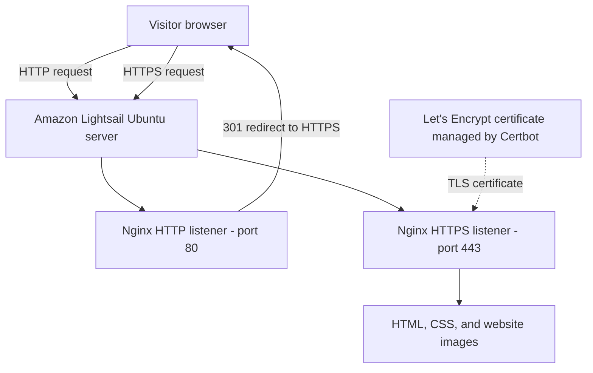
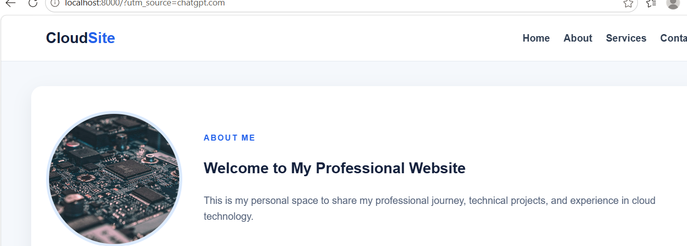

# CloudSite — Static Website Hosting Project

## Project Overview

CloudSite is a static website built with HTML, CSS, and image assets. This project demonstrates practical skills in Linux system administration, web hosting, and Infrastructure as Code.

## Website Features

- HTML website content
- CSS styling and page layout
- Navigation links
- Image assets
- Nginx web hosting on Ubuntu Linux

## Technology Stack

- HTML5 and CSS3
- Ubuntu Linux
- Nginx
- Amazon Lightsail
- AWS S3 and Terraform for a separate static website hosting lab
- Let's Encrypt and Certbot for HTTPS

## Project Files

- `index.html` — website content
- `style.css` — website styling
- `images/` — website images
- `main.tf` — Terraform configuration
- `variables.tf` — Terraform input variable definitions
- `outputs.tf` — Terraform output definitions
- `.gitignore` — excludes local and sensitive files

## Run a Local Preview

From this directory, run:

    python3 -m http.server 8000

Then open http://localhost:8000 in your browser.

Press Ctrl+C in the terminal to stop the preview server.

## Deployment

CloudSite was deployed to an Ubuntu server on Amazon Lightsail and served through Nginx. HTTPS was configured with Certbot and Let's Encrypt.

The Terraform files in this repository belong to the AWS S3 hosting lab and should be reviewed separately from the Lightsail deployment.

## Security

- Never commit AWS credentials or private SSH keys.
- Do not commit Terraform state files or secret variable values.
- Do not publish certificate private keys.
- Review all files before making this repository public.

## Future Improvements

- Add a Python Flask backend.
- Add a database for persistent data.
- Implement secure form handling and authentication.
- Automate deployment with a CI/CD pipeline.

## Architecture Diagram

CloudSite runs on an Ubuntu Lightsail instance. Nginx listens on
HTTP port 80 and HTTPS port 443. HTTP requests are redirected to
HTTPS, and Nginx serves the static website files.

## Screenshots

### CloudSite homepage

The screenshot shows the portfolio version of the CloudSite website.
The live website is hosted separately on Amazon Lightsail.

## Infrastructure as Code

The Terraform files in this repository belong to the separate AWS S3
hosting lab. They should not be interpreted as provisioning the
Lightsail server shown in the runtime architecture diagram.
